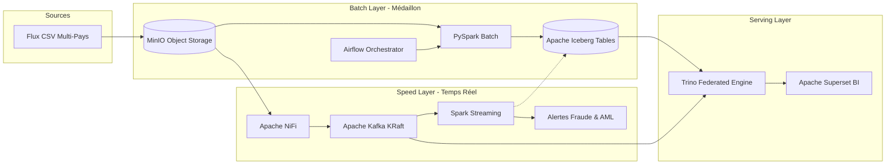

# Note de Synthèse & Write-Up Technique : Architecture Data Lakehouse Lambda WABA Group

**Auteur :** Armel Kouadio  
**Projet :** Plateforme Moderne de Données BancAssur & Mobile Money  
**Organisation :** WestAfrica BancAssur Group (WABA Group)  
**Date :** Octobre 2026  

---

## 1. Contexte Opérationnel et Problématique Métier

**WestAfrica BancAssur Group (WABA Group)** opère dans huit pays d'Afrique de l'Ouest : sept États membres de l'Union Économique et Monétaire Ouest-Africaine (**UEMOA** : Côte d'Ivoire, Sénégal, Mali, Burkina Faso, Guinée, Togo, Bénin) et le **Ghana**. Ses activités couvrent quatre lignes de métier majeures : la Banque Retail & Corporate, l'Assurance Vie & IARD, les Paiements Mobile Money et la Microfinance.

Chaque filiale s'appuie historiquement sur des systèmes d'information disparates et silotés :
- Core Banking Temenos T24 pour la banque traditionnelle,
- Systèmes CBS Insurance pour la gestion des polices et sinistres,
- Passerelles API des opérateurs télécoms partenaires (Orange, MTN, WABA Pay) pour le mobile money,
- Outils d'agences décentralisés pour la microfinance rurale.

Cette fragmentation entraînait trois verrous majeurs :
1. **L'incapacité d'obtenir une vision consolidée du risque de crédit** (ratios NPL consolidés exigés par la Banque Centrale des États de l'Afrique de l'Ouest - **BCEAO**).
2. **Des retards critiques dans la production des états prudentiels** (échéances CIMA pour le secteur assurantiel et déclarations de soupçon AML/CFT).
3. **L'absence de détection en temps réel des fraudes transactionnelles** et de suivi des couloirs transfrontaliers d'argent mobile en forte croissance (ex: flux Côte d'Ivoire $\leftrightarrow$ Sénégal, Mali $\leftrightarrow$ Burkina Faso).

Pour répondre à ces enjeux, nous avons conçu et déployé une plateforme de données unifiée reposant sur un **Pattern Lambda** centré sur un **Data Lakehouse moderne (MinIO + Apache Iceberg)**, orchestré par **Apache Airflow** et fédéré par **Trino SQL**, avec une chaîne temps réel **Apache NiFi + Kafka + Spark Structured Streaming** conteneurisée sur **Kubernetes**.

---

## 2. Choix d'Architecture et Justification Technologique

### 2.1 Le Pattern Lambda (Batch + Speed Layer)
Un dilemme classique opposait l'architecture Kappa (tout en streaming) au pattern Lambda. Pour une institution financière multi-pays, **le pattern Lambda a été retenu** pour les raisons suivantes :
- **Exigence d'auditabilité comptable et déclarative (Batch Layer) :** Les déclarations prudentielles BCEAO et CIMA exigent des agrégations à date fixe J+1 avec une exactitude comptable absolue (garantie ACID), un retraitement historique sans faille (*time-travel*) et des volumétries massives.
- **Réactivité immédiate sur la fraude et le risque (Speed Layer) :** La détection d'attaques par vélocité (retraits massifs successifs en moins de 5 minutes) et le filtrage des virements supérieurs aux seuils AML (1 000 000 XOF / 5 000 GHS) nécessitent une latence de l'ordre de la seconde.
- **Requête unifiée via Trino :** Trino permet de combler le fossé historique en exécutant des jointures SQL directes entre la table Iceberg Batch et le topic Kafka streaming (connecteur natif), réconciliant fraîcheur des données et profondeur analytique.

### 2.2 Format de Table : Apache Iceberg sur MinIO Object Storage
Face aux limitations du format Parquet brut (pas d'ACID, corruption en cas d'écriture concurrente, partitionnement rigide) ou de Delta Lake (plus dépendant de l'écosystème Databricks), **Apache Iceberg s'est imposé** :
- **Garanties ACID & Idempotence :** L'instruction `MERGE INTO` native d'Iceberg permet d'ingérer les fichiers bancaires de manière rigoureusement idempotente. Le rejeu accidentel d'un fichier source ne génère aucun doublon.
- **Évolution de Schéma & Partition Evolution :** Les réglementations bancaires africaines évoluant rapidement, Iceberg autorise la modification de schéma (ajout de colonnes PII, modifications de taxes) sans réécriture coûteuse des partitions.
- **Time-Travel & Auditabilité Réglementaire :** Possibilité d'interroger l'état exact des tables à n'importe quel instant passé (`FOR SYSTEM_TIME AS OF`), crucial lors des contrôles sur place de la Commission Bancaire de l'UMOA.
- **MinIO S3 :** Solution de stockage objet S3-compatible leader, déployable sur site (on-premise) ou dans des cloud souverains ouest-africains (ex: MainOne, Orange Cloud), garantissant la stricte souveraineté des données financières.

### 2.3 Moteur de Requêtage Fédéré : Trino
Trino (ex-PrestoSQL) agit comme le point d'entrée SQL universel :
- Capacité à requêter directement les métadonnées Iceberg sans passer par des copies de données.
- Connecteur Kafka intégré permettant d'exécuter la requête Lambda canonique qui cumule l'historique batch et le flux en mémoire.
- Connexion transparente avec Apache Superset via SQLAlchemy.

---

## 3. Architecture Médaillon et Modélisation Fonctionnelle

La structuration des données au sein du bucket central `lakehouse` s'articule selon l'Architecture Médaillon :

### 3.1 Couche Bronze (`bronze.*`)
- Réception brute des fichiers CSV depuis `raw-landing`.
- Validation stricte des types de données et rejet immédiat des enregistrements malformés vers la file d'erreur.
- Partitionnement optimisé par `country_code` et `ingestion_date`.
- Tables : `bronze.bank_transactions`, `bronze.insurance_operations`, `bronze.mobile_money_payments`, `bronze.loan_repayments`, et les référentiels `customers`, `accounts`, `branches`, `products`.

### 3.2 Couche Silver (`silver.*`)
- **Déduplication stricte** sur les clés uniques (`transaction_id`, `operation_id`, etc.).
- **Enrichissement référentiel :** Jointures avec les tables clients, agences et comptes pour injecter le segment client (Retail, SME, Corporate, Premium) et le niveau KYC (Basic, Standard, Enhanced).
- **Normalisation monétaire universelle :** Conversion systématique des montants en devises locales vers l'Euro (**EUR**) :
  - Zone UEMOA : Parité fixe légale $1\text{ EUR} = 655,957\text{ XOF}$.
  - Zone Ghana : Taux de change flottant paramétrable ($1\text{ GHS} \approx 0,065\text{ EUR}$).
- **Gouvernance PII :** Masquage systématique des identifiants sensibles (`account_id` masqué en `WABA-CI-A-***1234`).

### 3.3 Couche Gold (`gold.*`) : KPIs et Ratios Réglementaires
Les 7 tables Gold répondent aux besoins stratégiques et prudentiels :
1. `gold.daily_transaction_volume` : Volume, montant consolidé EUR, frais perçus et taux de succès par pays, entité et canal.
2. `gold.npl_ratio_by_country` : Ratio des créances douteuses ($\text{NPL} = \frac{\text{Encours en défaut}}{\text{Encours total}}$) confronté au **seuil prudentiel BCEAO de 5%**. Statut tricolore (vert $<3\%$, orange $3-5\%$, rouge $>5\%$).
3. `gold.customer_arpu_monthly` : Revenu Moyen Par Client ($\frac{\sum \text{Commissions}}{\text{Clients Actifs}}$) par segment.
4. `gold.loss_ratio_by_product` : Ratio Sinistres/Primes (S/P) en assurance confronté au **seuil de surveillance CIMA de 70%**.
5. `gold.claims_processing_time` : Délais moyens de liquidation des sinistres en jours ouvrés et taux de respect du SLA contractuel (30 jours).
6. `gold.mobile_money_daily_flow` : Débit quotidien des flux de portefeuilles digitaux, taux d'échec opérateur et utilisateurs actifs uniques.
7. `gold.cross_border_transfers` : Analyse matricielle des corridors régionaux UEMOA (ex: flux entrants/sortants Côte d'Ivoire $\leftrightarrow$ Sénégal, Bénin $\leftrightarrow$ Togo).

---

## 4. Pipeline Streaming & Détection Temps Réel

Le flux temps réel opère sans friction entre Apache NiFi, Kafka et Spark Structured Streaming :
- **Apache NiFi :** Détecte l'arrivée des fichiers CSV sur S3 via `ListS3`/`FetchS3Object`, découpe les lignes, injecte l'horodatage `ingestion_timestamp` et la traçabilité `source_file`, et publie dans Kafka avec régulation de la contre-pression (*back-pressure* à 20 000 messages / 2 GB).
- **Kafka KRaft :** 10 topics organisés par niveau de maturité (Raw, Silver, Gold Alerts, et Dead Letter Queue `dlq-financial-events`).
- **Spark Streaming Job 1 (Raw -> Silver) :** Valide le JSON, dérive les erreurs vers la DLQ, applique une fenêtre glissante de déduplication de 10 minutes avec *watermark*, convertit en EUR, et alimente simultanément Kafka et Iceberg.
- **Spark Streaming Job 2 (Silver -> Gold Alerts) :**
  - **Règle Fraude Vélocité :** Détection de transactions cumulées $> 500\,000\text{ XOF}$ en moins de 5 minutes sur le même compte via une fenêtre glissante de 5 min (glissement 1 min).
  - **Règle Conformité AML :** Filtrage instantané de tout virement $> 1\,000\,000\text{ XOF}$ (UEMOA) ou $> 5\,000\text{ GHS}$ (Ghana) vers le topic `gold-aml-events` pour déclaration aux cellules de renseignement financier (CENTIF).
  - **Alerte Liquidité :** Détection de sorties de fonds massives par pays excédant le seuil de couverture prudentiel.

---

## 5. Gouvernance, Sécurité & Observabilité (Production-Grade)

### 5.1 Sécurité & Authentification SSO (Keycloak)
Le serveur d'identité Keycloak centralise le contrôle d'accès avec 4 rôles RBAC bien définis :
- `group_admin` : Accès global de supervision sur l'ensemble des filiales et couches.
- `country_analyst` : Accès strictement restreint aux données de son pays (implémenté via Row-Level Security dans Trino).
- `compliance_officer` : Accès dédié aux tables Gold réglementaires (BCEAO, CIMA, alertes AML).
- `viewer` : Accès restreint en lecture seule avec masquage dynamique des données PII (IBAN, numéros de compte masqués).

### 5.2 Catalogue de Données & Lignage (OpenMetadata)
- Découverte automatique des métadonnées du Lakehouse Iceberg.
- Traçabilité complète du lignage (*lineage*) de bout en bout : `raw-landing (CSV) -> bronze -> silver -> gold -> reporting réglementaire`.
- Classification automatique et marquage PII sur les colonnes `customer_id`, `account_id` et coordonnées sensibles.

### 5.3 Observabilité Intégrée (Prometheus, Grafana, Loki)
- Collecte des métriques d'infrastructure et applicatives via Prometheus.
- Centralisation des logs applicatifs Spark/Airflow avec parsing JSON dans Loki via Promtail.
- **3 Alertes Grafana configurées :**
  1. *Spark Fraud Job Inactif* $> 5$ minutes (sévérité critique).
  2. *Consumer Lag Kafka AML* $> 5\,000$ messages (sévérité haute).
  3. *Échec du DAG réglementaire `dag_regulatory_report`* à J+1 06h00 UTC (sévérité désastre).

---

## 6. Compromis Techniques (*Trade-offs*) et Limitations Connues

| Dimension | Choix Retenu | Compromis Effectué | Justification & Alternatives Futures |
|---|---|---|---|
| **Moteur Streaming** | Micro-batching Spark Structured Streaming (1-5 sec) | Latence légèrement supérieure au streaming pur (ex: Apache Flink < 50ms) | Spark unifie le code Batch et Streaming (API DataFrame commune) et dispose du connecteur Iceberg le plus mature. Une migration Flink pourra être envisagée pour des besoins ultra-haute fréquence. |
| **Idempotence & Deduplication** | Watermark temporel de 10 min sur Spark Streaming | Risque théorique de doublons si un événement arrive avec plus de 10 min de retard réseau | Arbitrage indispensable pour plafonner l'empreinte mémoire d'état (*StateStore*). Les doublons résiduels tardifs sont éliminés lors de la consolidation Batch J+1. |
| **Stockage Objet** | MinIO local / S3 on-premise | Gestion manuelle du cycle de vie des disques physiques | Impératif de conformité réglementaire sur la souveraineté des données financières en zone UEMOA. |
| **Requête Lambda Unifiée** | Jointure SQL `FULL OUTER JOIN` Trino (Iceberg + Kafka) | Coût de scanning du topic Kafka lors de chaque requête analytique interactive | Recommandé pour les dashboards opérationnels intra-journaliers. Pour les analyses historiques pluriannuelles, requêter exclusivement la table Iceberg consolidée. |

---

## 7. Conclusion

Cette plateforme confère à **WestAfrica BancAssur Group** un avantage concurrentiel déterminant :
- Une **réconciliation financière automatisée** entre 8 filiales et 4 métiers sous devises hétérogènes.
- Une **conformité réglementaire sans faille** vis-à-vis des exigences prudentielles de la BCEAO et de la CIMA.
- Une **surveillance en temps réel des fraudes et des flux d'argent mobile** à l'échelle régionale ouest-africaine.
- Une architecture hautement résiliente, modulaire, déployable aussi bien via Docker Compose en phase de test que sur un cluster Kubernetes de classe entreprise.
